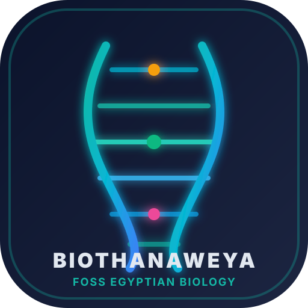

# 🧬 BioThanaweya (البيولوجيا للثانوية العامة - لغات)

<p align="center">
  
</p>

<p align="center">
  <strong>Elite Egyptian Thanaweya Amma Biology Learning Platform & Ministry Exam Simulator</strong><br>
  <em>Next-Gen 3D Biology &amp; Automation Ecosystem with direct APK distribution.</em><br>
  <em>منظومة متقدمة لمراجعة واختبار مادة الأحياء لطلاب مدارس اللغات وفق أحدث معايير ونماذج إجابة وزارة التربية والتعليم المصرية</em>
</p>

<p align="center">
  <a href="https://github.com/AlySelim2001/BioThanaweya/actions/workflows/android-apk-build.yml"></a>
  <a href="https://github.com/AlySelim2001/BioThanaweya/actions/workflows/android-apk-build.yml"></a>
  <a href="LICENSE"></a>
  <a href="https://nodejs.org"></a>
  <a href="https://www.typescriptlang.org"></a>
  <a href="https://web.dev/progressive-web-apps/"></a>
  <a href="https://termux.dev"></a>
</p>

<p align="center">
  <a href="https://github.com/AlySelim2001/BioThanaweya/releases/download/v1.1.0/app-debug.apk">
    
  </a>
</p>

<p align="center">
  <em>Direct download of the latest successful Android APK build artifact (debug) from GitHub Actions.</em>
</p>

<p align="center">
  🌐 <strong>Live Landing Page:</strong> <a href="https://alyselim2001.github.io/BioThanaweya/">https://alyselim2001.github.io/BioThanaweya/</a>
</p>

---

## 📖 Table of Contents / فهرس المحتويات

- [🇪🇬 نبذة عامة ومعايير الوزارة (Arabic Overview)](#-نبذة-عامة-ومعايير-الوزارة)
- [🌟 7-Agent AI Learning Framework](#-7-agent-ai-learning-framework)
- [🏛️ Repository Architecture & Directory Structure](#️-repository-architecture--directory-structure)
- [📱 Termux & Mobile Android Setup (دليل تشغيل تيرمكس)](#-termux--mobile-android-setup)
- [📥 Download Android APK (تحميل تطبيق الأندرويد)](#-download-android-apk-تحميل-تطبيق-الأندرويد)
- [📲 PWA Offline Installation (التثبيت على الهاتف)](#-pwa-offline-installation)
- [💾 Local Storage & JSON Vault (قاعدة البيانات وإدارة البيانات)](#-local-storage--json-vault)
- [🔬 Interactive Formula Lab (معمل حل مسائل الأحياء)](#-interactive-formula-lab)
- [🛠️ Developer Field Guide (دليل المطور الميداني)](DEVELOPER_GUIDE.md)
- [🤝 Contributing & Community (المساهمة والتطوير)](#-contributing--community)
- [📄 License & Attribution](#-license--attribution)

---

## 🇪🇬 نبذة عامة ومعايير الوزارة (Arabic Overview)

صُمم تطبيق **BioThanaweya** ليكون الأداة التفاعلية الأولى المجانية بالكامل (100% FOSS) والمفتوحة المصدر الموجهة لطلاب الثانوية العامة (مدارس اللغات والرسمية المتميزة والتجريبية لغات والخاصة لغات)، لتغطية منهج علم الأحياء (Biology Syllabus) للوحدتين:

1. **Unit 1: Structure and Function in Living Organisms**
   - Support and Movement in Living Organisms (الدعامة والحركة).
   - Hormonal Coordination (التنسيق الهرموني).
   - Reproduction in Living Organisms (التكاثر).
   - Immunity in Living Organisms (المناعة).
2. **Unit 2: Molecular Biology**
   - DNA and Genetic Information (الحمض النووي والمعلومات الوراثية).
   - RNA, Genetic Code and Protein Synthesis (الأحماض النووية وتخليق البروتين والتكنولوجيا الجزيئية).

### ⚖️ صرامة نماذج الإجابة (Ministry Mark Schemes)

يحتوي النظام على محرك تدقيق يماثل نماذج تصحيح مستشاري المادة بالوزارة، ويقوم باحتساب الخصومات الإلزامية في حال إغفال:

- الأيونات المحورية مثل الكالسيوم ($Ca^{2+}$) في تحفيز انطلاق الأسيتيل كولين وتكوين الروابط المستعرضة.
- الإنزيمات الحيوية مثل الكولين إستريز ($Cholinesterase$) لعودة الغشاء لحالة الاستقطاب، وإنزيمات الربط واللملمة في تضاعف الـ DNA.
- المناطق الهيكلية للقطعة العضلية ($A-band, I-band, H-zone, Z-lines$).

---

## 🌟 7-Agent AI Learning Framework

BioThanaweya integrates a 7-agent pedagogical scaffolding system:

| Agent       | Role                                 | Educational Scaffolding                                                                                                                    |
| :---------- | :----------------------------------- | :----------------------------------------------------------------------------------------------------------------------------------------- |
| **Agent 1** | **Master Biology Educator**          | Dual-layer explanations: deep technical molecular mechanics paired with Egyptian Arabic ELI5 analogies, with Bloom's Taxonomy progression. |
| **Agent 2** | **Visual Learning Architect**        | Monospace LTR ASCII schematics, visual inspection cues, and diagram recognition markers.                                                   |
| **Agent 3** | **Assessment Specialist**            | Authentic Ministry question types (_Scientific Term_, _Give Reason_, _What Happens If_, _MCQ_), unmasking Exam Traps and golden rules.     |
| **Agent 4** | **Ministry Examiner & FSRS Engine**  | Keyword deduction grading and modern spaced repetition scheduling based on FSRS v4.5/v5 parameters.                                        |
| **Agent 5** | **Metacognitive Evaluator**          | Confidence-accuracy calibration widget detecting overconfidence bias (Dunning-Kruger) and underconfidence imposter doubt.                  |
| **Agent 6** | **Problem-Based Learning (PBL)**     | Real-world toxicology cases, autoimmune disorders, and genetic engineering missions with rubric grading.                                   |
| **Agent 7** | **Student Wellbeing & Gamification** | Active study streaks, XP progression, achievement badges, anxiety scoring, and Pomodoro study intervals.                                   |

---

## 🏛️ Repository Architecture & Directory Structure

```text
AlySelim2001/BioThanaweya
├── .github/
│   └── workflows/
│       └── ci.yml               # Automated GitHub Actions CI (Node 22, Lint & Build)
├── .env.example                 # Zero-trust environment configuration template
├── .gitignore                   # Production ignore file for Node.js, Vite & secrets
├── LICENSE                      # Official MIT License (100% FOSS)
├── CONTRIBUTING.md              # Community guidelines & PR conventions
├── README.md                    # Comprehensive bilingual documentation
├── index.html                   # HTML5 mobile viewport & PWA meta tags
├── package.json                 # FOSS dependencies & dual runtime commands
├── package-lock.json            # Deterministic dependency lock
├── tsconfig.json                # Strict TypeScript configuration with PWA types
├── vite.config.ts               # Vite 6 bundler with Tailwind CSS v4 & VitePWA
├── server.ts                    # Low-resource Express server with 128MB memory guard
├── public/                      # Static assets & Web App Manifest icons
│   ├── icon.svg                 # High-contrast vector brand icon
│   ├── pwa-192x192.png          # Android home-screen icon (192px)
│   ├── pwa-512x512.png          # High-resolution splash icon (512px)
│   ├── pwa-maskable-512x512.png # Adaptive maskable Android icon
│   └── apple-touch-icon.png     # iOS Safari touch icon (180x180)
└── src/                         # Application source code (Clean Architecture)
    ├── main.tsx                 # React 19 client bootstrap
    ├── App.tsx                  # Main router, state coordinator & modal mounts
    ├── types/                   # Relational domain schemas & TypeScript types
    ├── services/                # Business logic, FSRS algorithm & database
    │   ├── db/
    │   │   ├── indexedDbEngine.ts # 100% FOSS client-side IndexedDB engine
    │   │   └── backupService.ts   # JSON export/import & rolling auto-snapshots
    │   ├── storage.ts           # Ultra-fast memory cache + async persistence bridge
    │   ├── curriculumRepository.ts # Official Ministry syllabus content
    │   ├── examinerEngine.ts    # Model answer evaluation & deduction grading
    │   ├── fsrs.ts              # Spaced repetition scheduling calculation
    │   └── calculators.ts       # Sarcomere, Chargaff, and Codon mathematical solvers
    ├── components/              # Modular UI components
    │   ├── Navbar.tsx           # Brand header, sync indicator & PWA install trigger
    │   ├── StorageVaultModal.tsx# Visual database manager, quota meter & backup controls
    │   ├── PWAInstallButton.tsx # Standalone home-screen install trigger (Android/iOS)
    │   └── SevenAgentsModal.tsx # Educational scaffolding breakdown modal
    └── screens/                 # Full application views
        ├── DashboardScreen.tsx  # Curriculum hub & chapters view
        ├── TopicDetailScreen.tsx# Educator explanations & ASCII schematics
        ├── PracticeScreen.tsx   # Ministry exam practice & trap solver
        ├── FormulaLabScreen.tsx # Interactive biological formula calculators
        ├── FsrsReviewScreen.tsx # Spaced repetition flashcard review
        ├── SimulatedExamScreen.tsx # Timed 45-minute Ministry simulated examination
        └── SettingsScreen.tsx   # Pomodoro timing & database storage vault
```

---

## 📥 Download Android APK (تحميل تطبيق الأندرويد)

Get the latest Android build directly from the CI/CD pipeline:

<p align="center">
  <a href="https://github.com/AlySelim2001/BioThanaweya/releases/download/v1.1.0/app-debug.apk">
    
  </a>
</p>

- **Direct Download:** Download the compiled APK directly from the [GitHub Release v1.1.0 asset](https://github.com/AlySelim2001/BioThanaweya/releases/download/v1.1.0/app-debug.apk).
- **Artifact:** `BioThanaweya-debug-apk` (uploaded by the `android` job, retained 30 days).
- **Source:** [GitHub Actions – Android APK Build](https://github.com/AlySelim2001/BioThanaweya/actions/workflows/android-apk-build.yml)
- **Architecture:** Flutter / Capacitor / Android hybrid (React + Vite web bundle wrapped via Capacitor 8).

---

## 📱 Termux & Mobile Android Setup

تطبيق BioThanaweya مُحسّن تماماً للعمل داخل بيئة **Termux** على هواتف أندرويد ذات الإمكانيات المحدودة مع حماية الذاكرة العشوائية تحت سقف 128MB RAM:

```bash
# 1. تحديث حزم تيرمكس وتثبيت Node.js و Git
pkg update -y && pkg install nodejs-lts git -y

# 2. استنساخ المستودع والدخول للمجلد
git clone https://github.com/AlySelim2001/BioThanaweya.git
cd BioThanaweya

# 3. تثبيت التبعيات المجانية
npm install

# 4. تشغيل خادم التطبيق المتكامل (Full-Stack Mode مع قاطع دائرة الذاكرة)
npm run dev

# 5. أو تشغيل واجهة الويب الخفيفة للعميل فقط (Client-Only Mode)
npm run dev:client
```

_افتح المتصفح على الهاتف وانتقل إلى:_ `http://localhost:3000`

---

## 📲 PWA Offline Installation (التثبيت على الهاتف)

BioThanaweya operates as a true Progressive Web App with 100% offline capability:

- **Android (Chrome / Brave / Edge)**:
  - اضغط على زر **Install App** الموجود في شريط التنقل العلوي أو قائمة المتصفح (`⋮`) ثم اختر **Install App** / **Add to Home Screen**.
  - سيظهر التطبيق على الشاشة الرئيسية للهاتف ويعمل بشاشة كاملة وبدون شريط عنوان المتصفح.
- **iOS (Safari)**:
  - اضغط على زر **المشاركة** (Share icon) في شريط سفاري السفلي.
  - اختر **Add to Home Screen** (إضافة إلى الصفحة الرئيسية).
- **Offline Reliability**:
  - يقوم الـ Service Worker بتخزين جميع ملفات الـ JavaScript والـ CSS والخطوط والبيانات محلياً للعمل بدون إنترنت نهائياً.

---

## 💾 Local Storage & JSON Vault (قاعدة البيانات وإدارة البيانات)

- **IndexedDB Relational Engine (`BioThanaweyaDB_v1`)**:
  - يتجاوز حد الـ 5MB المحدود لـ `localStorage` لتخزين آلاف الكروت والامتحانات وسجلات المراجعة.
- **Auto-Snapshots (لقطات الحفظ التلقائية)**:
  - يتم أخذ نسخة احتياطية ذاتية بعد كل امتحان أو جلسة مراجعة مع الاحتفاظ بآخر 5 لقطات متداولة.
- **1-Click JSON Backup & Restore (تصدير واستيراد البيانات)**:
  - اضغط على أيقونة **Local DB** في شريط التنقل لفتح **Storage Vault**.
  - حمّل نسخة احتياطية من كل تقدمك التعليمي بنقرة واحدة بصيغة JSON لنقلها لأي جهاز آخر واستعادتها بسلاسة.

---

## 🔬 Interactive Formula Lab (معمل حل مسائل الأحياء)

يتضمن التطبيق حواسب فورية للمسائل الرياضية وفق القوانين الإلزامية للثانوية العامة:

1. **Sarcomere Landmark Solver**:
   - حساب $Z-lines = n + 1$، $A-bands = n$، $I_{complete} = n - 1$.
   - التحقق من ثبات طول المنطقة الداكنة وانعدام المنطقة شبه المضيئة ($H = 0$) أثناء الانقباض التام.
2. **Chargaff DNA Helix Calculator**:
   - التحقق من تكافؤ البيورينات والبيريميدينات ($A = T$, $G = C$, $Purines = 50\%$).
   - حساب عدد اللفات (10 أزواج قواعد لكل لفة)، وعدد الروابط الهيدروجينية ($2A + 3G$).
3. **Translation & Codon Calculator**:
   - حساب عدد الأحماض الأمينية المستخلصة، استثناء كودون الوقف، حساب جزيئات الماء المفقودة، وعدد روابط الببتيد.

---

## 🤝 Contributing & Community (المساهمة والتطوير)

المشروع مفتوح للمساهمات من المطورين والمعلمين والطلاب. نرجو مراجعة دليل المساهمة [CONTRIBUTING.md](CONTRIBUTING.md) للتعرف على:

- معايير كتابة الكود النظيف (Clean Code Standards).
- قواعد التسمية في Git والرسائل الموحدة (Conventional Commits).
- خطوات إجراء التحقق القبلي (`npm run lint` و `npm run build`).

---

## 📄 License & Attribution

Distributed under the **MIT License**. See [LICENSE](LICENSE) for details.  
100% Free and Open Source Software (FOSS). Developed with pride for Egyptian Thanaweya Amma students. 🇪🇬🧬

---

## 👨‍💻 Developer & Support

- **Developer:** Alyselim
- **Phone / Contact:** 📱 +201119886662

> For support, feature requests, or collaboration inquiries, please reach out via the contact above or open an issue on GitHub.
