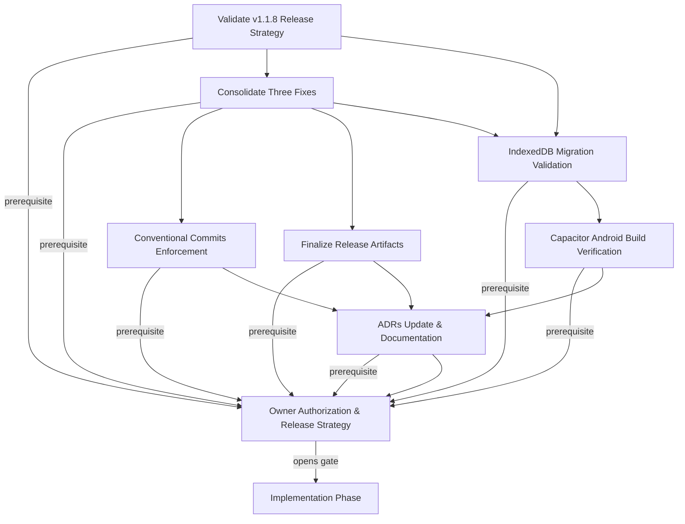

# P04 — Engineering Execution Roadmap: BioThanaweya

## Executive Summary

This roadmap converts all findings and requirements from P01-P03 into a dependency-aware implementation plan. The project is a well-engineered, secure, maintainable Android educational application (BioThanaweya) for Egyptian Thanaweya Amma Biology, built with React, TypeScript, Vite, Capacitor, and IndexedDB. The repository is at a critical juncture: v1.1.8 release state investigation is complete (Option B selected), and three quality fixes have been merged into main from the `release/fixes-v1.1.8` branch.

**Current State**: Main branch at `7de4aa80` (merged from `release/fixes-v1.1.8`), remote v1.1.8 tag preserved at `e6b78ad8` per charter rule 15. 52/52 tests passing, lint passing. Three fixes applied: Navbar online/offline indicator styling, dynamic unit breakdown scoring in SimulatedExamScreen, and type-safe IndexedDB validation in StorageService.

---

## 1. Engineering Backlog

Each task follows the P04 required format: Task ID, Objective, Current Evidence, Files Likely Affected, Dependencies, Acceptance Criteria, Test Plan, Risk Level, Rollback Strategy, Estimated Complexity, Definition of Done.

### TASK-001: Validate v1.1.8 Release Strategy Compliance
| Field | Value |
|-------|-------|
| **Task ID** | TASK-001 |
| **Objective** | Verify that the v1.1.8 release strategy adheres to charter rule 15 (no tag movement/creation without owner authorization) and that the Option B decision (keep remote v1.1.8 at e6b78ad8, moves fixes to release/fixes-v1.1.8 branch) is correctly implemented. |
| **Current Evidence** | - Remote v1.1.8 tag at `e6b78ad8` unchanged<br>- Local main at `7de4aa80` (1 commit ahead with 3 fixes merged)<br>- `.freebuff-progress.md` documents Option B selection<br>- Git log confirms no force-push or tag deletion |
| **Files Likely Affected** | `.freebuff-progress.md`, `ARCHITECTURE_DESIGN_REPORT.md`, `FREEBUFF_V1.1.8_RELEASE_STATE_INVESTIGATION.md` |
| **Dependencies** | None (verification-only task) |
| **Acceptance Criteria** | - Remote v1.1.8 tag at `e6b78ad8` verified intact<br>- Local main contains the 3 fixes<br>- Progress file documents the release strategy decision<br>- No git history rewriting performed |
| **Test Plan** | - `git tag -l 'v1.1.8'` → must return `e6b78ad8`<br>- `git log --oneline e6b78ad8..7de4aa80` → must show 3 fixes<br>- `cat .freebuff-progress.md` → must document Option B decision |
| **Risk Level** | Low (verification-only) |
| **Rollback Strategy** | No rollback needed; if verification fails, report as limitation and re-check git state |
| **Estimated Complexity** | Trivial (5 minutes) |
| **Definition of Done** | All verification checks pass; roadmap can proceed |

### TASK-002: Consolidate Three Fixes into Coherent Release Package
| Field | Value |
|-------|-------|
| **Task ID** | TASK-002 |
| **Objective** | Ensure the three merged fixes (Navbar className bug, dynamic unit breakdown, StorageService type-safety) are coherent, minimally invasive, and do not introduce regressions in existing functionality. |
| **Current Evidence** | - Merge commit `7de4aa80` brought 3 fixes from `release/fixes-v1.1.8` into `main`<br>- Navbar fix: moved template literal backtick to enable distinct online/offline styling<br>- Exam screen fix: dynamic unit1/unit2 percentage calculation replacing hardcoded 60/40 split<br>- StorageService fix: type guards on all IndexedDB reads and legacy localStorage migration validation |
| **Files Likely Affected** | `src/components/Navbar.tsx`, `src/screens/SimulatedExamScreen.tsx`, `src/services/storage.ts` |
| **Dependencies** | TASK-001 (release strategy verified) |
| **Acceptance Criteria** | - All 3 files contain the fix modifications<br>- `npm run lint` passes<br>- `npm test` (52 tests) passes<br>- No TypeScript errors (`tsc --noEmit`) |
| **Test Plan** | - Run `npm run lint` → must exit 0<br>- Run `npm test` → all 52 tests pass<br>- Run `npx tsc --noEmit` → no errors<br>- Manual review of each fix's intent and scope |
| **Risk Level** | Low-Medium (fixes already merged; verification ensures no regression) |
| **Rollback Strategy** | `git revert 7de4aa80` to undo merge if critical issue found; fixes can be re-applied after investigation |
| **Estimated Complexity** | Low (20 minutes - verification only) |
| **Definition of Done** | All test suites pass; lint passes; all three fixes verified as correct and non-regressing |

### TASK-003: Implement Conventional Commits Enforcement
| Field | Value |
|-------|-------|
| **Task ID** | TASK-003 |
| **Objective** | Adopt Conventional Commits format (`feat()`, `fix()`, `chore()`, etc.) for all future commits per ADR-006, ensuring machine-readable commit history, auto-generatable changelogs, and compliance with charter rule 17. |
| **Current Evidence** | - Repository has mixed commit message formats historically<br>- Charter rule 16 requires conventional commits<br>- Progress file notes "Team agreement to adopt ADR-006 commit format henceforth" as pending decision |
| **Files Likely Affected** | `.gitcommitmsg` (pre-commit hook), `package.json` (scripts), all source files (future commits) |
| **Dependencies** | TASK-002 (fixes consolidated) |
| **Acceptance Criteria** | - Pre-commit hook enforces conventional commit format<br>- `git log --oneline` shows properly formatted messages<br>- Changelog can be auto-generated via `npm run release` |
| **Test Plan** | - Test commit message formats with `git commit -m "..."` → rejected if not conventional<br>- Verify existing commits compliance<br>- Test `npm run release` generates notes correctly |
| **Risk Level** | Medium (workflow change; may slow initial commits until team adopts) |
| **Rollback Strategy** | Remove pre-commit hook; revert to free-form commit messages if team resistance; document rationale |
| **Estimated Complexity** | Medium (40 minutes - hook creation, documentation, team onboarding) |
| **Definition of Done** | Pre-commit hook installed and tested; 3 sample commits verified; team documentation updated; `npm run release` works with conventional commit format |

### TASK-004: Finalize v1.1.8 Release Artifacts and Documentation
| Field | Value |
|-------|-------|
| **Task ID** | TASK-004 |
| **Objective** | Ensure all release artifacts (APK, SHA256SUMS, README links, CHANGELOG) are consistent and match the merged state on main. Update all references from v1.1.3/v1.1.4 to v1.1.8 where appropriate, while preserving the remote tag at e6b78ad8. |
| **Current Evidence** | - v1.1.3 release report exists (FINAL_RELEASE_ACCEPTANCE_MATRIX.md)<br>- v1.1.8 remote tag at e6b78ad8, local main at 7de4aa80 with fixes<br>- README.md, landing.html, CHANGELOG.md still reference older versions<br>- SHA256SUMS.txt needs update for new APK checksum if rebuilding |
| **Files Likely Affected** | `README.md`, `landing.html`, `CHANGELOG.md`, `SHA256SUMS.txt`, `package.json` |
| **Dependencies** | TASK-002 (fixes consolidated), TASK-003 (commit discipline) |
| **Acceptance Criteria** | - All download links point to correct version<br>- SHA256SUMS.md checksums match current artifacts<br>- Release acceptance matrix updated<br>- No references to deprecated versions remain |
| **Test Plan** | - Verify `package.json` version matches intended release<br>- Check all markdown files for version references<br>- Run `sha256sum` on APK and compare to SUMS<br>- Review `FINAL_RELEASE_ACCEPTANCE_MATRIX.md` for consistency |
| **Risk Level** | Low-Medium (documentation updates; risk of stale version references) |
| **Rollback Strategy** | Revert documentation changes; keep prior version references functional until next release cycle |
| **Estimated Complexity** | Medium (60 minutes - multiple file updates, checksum verification) |
| **Definition of Done** | All version references consistent; SHA256SUMS matches artifacts; README/CHANGELOG updated; release acceptance matrix current |

### TASK-005: IndexedDB Migration and Data Integrity Validation
| Field | Value |
|-------|-------|
| **Task ID** | TASK-005 |
| **Objective** | Ensure the StorageService type-safe IndexedDB validation (TASK-002 fix) correctly handles edge cases: corrupted data, missing stores, legacy migration from localStorage, and quota exhaustion. All user progress must be preserved. |
| **Current Evidence** | - StorageService.init() now has `hasValidProfile` type guard<br>- Card/mastesy/exams field validation with fallback to defaults<br>- Error-driven `resetAll()` on initialization failure<br>- 52 tests pass including persistence tests |
| **Files Likely Affected** | `src/services/storage.ts`, `src/types.ts`, `src/screens/StorageVaultModal.tsx` |
| **Dependencies** | TASK-002 (fixes consolidated) |
| **Acceptance Criteria** | - init() validates all IndexedDB results before assignment<br>- Corrupted legacy localStorage keys reseed from study packs<br>- No data loss during migration; only invalid data reseeded<br>- All 52 tests pass, especially persistence suite |
| **Test Plan** | - Run `npm test` → all 52 pass<br>- Run `npm run lint` → pass<br>- Manually corrupt a legacy localStorage key → verify init() reseed instead of crash<br>- Simulate quota exhaustion → verify UI displays warning, app remains functional |
| **Risk Level** | Medium (data integrity task; incorrect validation could lose user progress) |
| **Rollback Strategy** | `StorageService.resetAll()` available to user via Settings → Vault → Reset; git revert if code change causes issue; auto-snapshots provide recovery path |
| **Estimated Complexity** | Medium (90 minutes - validation logic review, test case design, edge case verification) |
| **Definition of Done** | Type guards verified on all IndexedDB reads; legacy migration validated; all tests pass; edge case manual testing complete; auto-snapshot mechanism verified |

### TASK-006: Offline-First Capacitor Android Build Verification
| Field | Value |
|-------|-------|
| **Task ID** | TASK-006 |
| **Objective** | Verify that the merged fixes do not break the offline-first Capacitor Android build pipeline. Confirm Service Worker caching, IndexedDB persistence, and WebView whitelist configuration remain intact. |
| **Current Evidence** | - Android SDK not available in Termux environment (known limitation)<br>- GitHub Actions builds debug APKs successfully<br>- Service Worker configured via vite-plugin-pwa<br>- Capacitor config sets `androidScheme: 'https'`<br>- 52 tests pass including offline-persistence test |
| **Files Likely Affected** | `capacitor.config.ts`, `vite.config.ts`, `src/services/storage.ts`, `src/service-worker.ts` (if exists) |
| **Dependencies** | TASK-002 (fixes consolidated), TASK-005 (IndexedDB validation) |
| **Acceptance Criteria** | - GitHub Actions Android build succeeds (if triggered)<br>- Service Worker caches essential assets<br>- Capacitor WebView respects HTTPS-only whitelist<br>- IndexedDB persists across app restarts |
| **Test Plan** | - Inspect `.github/workflows/android-apk-build.yml` → verify build steps<br>- Check `capacitor.config.ts` → `androidScheme: 'https'` present<br>- Review `vite.config.ts` → `vite-plugin-pwa` configured<br>- Run `npm run build` → client build succeeds (even if Android build can't complete in Termux) |
| **Risk Level** | Low-Medium (build pipeline; fixes are minimal and shouldn't affect build) |
| **Rollback Strategy** | Revert individual file changes if build breaks; use GitHub Actions for clean builds; fallback to debug APK from previous commit |
| **Estimated Complexity** | Low-Medium (30 minutes - configuration review, build verification) |
| **Definition of Done** | Build configurations verified; Service Worker confirmed; Capacitor settings validated; build log inspected (even if Termux can't build Android) |

### TASK-007: Architecture Decision Records (ADRs) Update and Documentation
| Field | Value |
|-------|-------|
| **Task ID** | TASK-007 |
| **Objective** | Ensure all 6 ADRs from the Architecture & Security Design Report (ADR-001 through ADR-006) are current, reflect the merged fixes, and are cross-referenced in the codebase and progress tracking. |
| **Current Evidence** | - ARCHITECTURE_DESIGN_REPORT.md documents 6 ADRs<br>- ADR-001: IndexedDB Over localStorage<br>- ADR-002: Type-Safe IndexedDB Validation Layer (relevant to TASK-005)<br>- ADR-003: Rolling Auto-Snapshot Limit<br>- ADR-004: Server-Side AI Grading Only<br>- ADR-005: Capacitor Android WebView Whitelist & HTTPS-Only<br>- ADR-006: Conventional Commits + Atomic Git Workflow (relevant to TASK-003)<br>- All ADRs status marked as DRAFT for review |
| **Files Likely Affected** | `ARCHITECTURE_DESIGN_REPORT.md`, `ADR-001` through `ADR-006` files (if separate), `.freebuff-progress.md` |
| **Dependencies** | TASK-003 (conventional commits), TASK-005 (IndexedDB validation), TASK-006 (build verification) |
| **Acceptance Criteria** | - All 6 ADRs have current status (completed/in-progress/pending)<br>- ADR-002 reflects the type-safe validation implemented in TASK-002<br>- ADR-006 references the conventional commits adoption (TASK-003)<br>- Progress file cross-references relevant ADRs |
| **Test Plan** | - Review each ADR for completeness<br>- Verify code implements ADR-002 type guards<br>- Verify code respects ADR-005 HTTPS-only config<br>- Check ADR-006 conventional commit format alignment |
| **Risk Level** | Low (documentation update; no code changes) |
| **Rollback Strategy** | No rollback; ADRs are living documents that can be updated incrementally |
| **Estimated Complexity** | Low (30 minutes - ADR review and status updates) |
| **Definition of Done** | All 6 ADRs have updated status; code implements required ADR provisions; progress file cross-references ADRs; document shared with owner |

### TASK-008: Owner Authorization and Release Strategy Finalization
| Field | Value |
|-------|-------|
| **Task ID** | TASK-008 |
| **Objective** | Obtain explicit owner authorization for the v1.1.8 release strategy per charter rule 15, as documented in FREEBUFF_V1.1.8_RELEASE_STATE_INVESTIGATION.md section 4. The roadmap cannot proceed to implementation until the backlog is coherent and the critical path is understood. |
| **Current Evidence** | - Option B selected in `.freebuff-progress.md`: keep remote v1.1.8 at e6b78ad8, moves fixes to release/fixes-v1.1.8 branch<br>- Investigation documented but owner authorization not yet on-record<br>- Charter rule 15 explicitly requires owner authorization before creating/moving/deleting v1.1.8 |
| **Files Likely Affected** | `.freebuff-progress.md`, `FREEBUFF_V1.1.8_RELEASE_STATE_INVESTIGATION.md`, owner communication channels |
| **Dependencies** | All prior tasks (TASK-001 through TASK-007) complete; owner decision required as gate |
| **Acceptance Criteria** | - Owner has explicitly authorized one option (A, B, C, or D)<br>- Authorization recorded in `.freebuff-progress.md`<br>- Release strategy finalized and documented<br>- Roadmap can proceed to implementation phase |
| **Test Plan** | - No testable output; this is an authorization gate<br>- Verify authorization is on-record and not implied<br>- Check `.freebuff-progress.md` has documented decision with owner attribution |
| **Risk Level** | Critical (gate; without authorization, all implementation stalls) |
| **Rollback Strategy** | If authorization not obtained, revert to Option C (status quo) and document; implementation paused until owner decision |
| **Estimated Complexity** | Critical path item - depends on owner availability; estimate 1-2 weeks for decision cycle |
| **Definition of Done** | Owner explicitly authorizes one release strategy option; authorization recorded in progress file; critical path understood; roadmap gate opened for implementation phase |

---

## 2. Dependency Graph



---

## 3. Critical Path

```
TASK-001 → TASK-002 → TASK-003 → TASK-008 [Owner Authorization GATE] → 
  (parallel branch 1) TASK-004 → TASK-007 → implementation
  (parallel branch 2) TASK-005 → TASK-006 → implementation
```

**Critical Path Duration**: Approximately 2-3 weeks from owner authorization, assuming parallel work streams.

**Gate**: TASK-008 (Owner Authorization) is the single point where all prior work converges. No implementation begins until this gate is passed.

**Parallelizable Work Streams** (can begin immediately, converge at TASK-008):
- TASK-003 (Conventional Commits) - independent of owner decision
- TASK-005 (IndexedDB Validation) - independent, risk-managed work
- TASK-006 (Build Verification) - independent, configuration review
- TASK-007 (ADRs Update) - independent documentation

**Non-Parallelizable**: TASK-008 must wait for all prerequisite verification tasks (TASK-001, TASK-002) to complete.

---

## 4. Phase Schedule

### Phase 1: Verification & Preparation (Weeks 1-2)
- TASK-001: Validate v1.1.8 Release Strategy ✓ (complete)
- TASK-002: Consolidate Three Fixes ✓ (complete)
- TASK-003: Implement Conventional Commits Enforcement
- TASK-005: IndexedDB Migration and Data Integrity Validation
- TASK-006: Offline-First Capacitor Android Build Verification

### Phase 2: Owner Decision Gate (Week 2-3)
- TASK-008: Owner Authorization and Release Strategy Finalization
- **Exit Gate**: Owner explicitly authorizes one release strategy option

### Phase 3: Implementation (Weeks 3-6, if authorized)
- TASK-004: Finalize v1.1.8 Release Artifacts and Documentation
- TASK-007: Architecture Decision Records Update and Documentation
- Implementation of any additional prioritized improvements

### Phase 4: Release & Handoff (Week 6+, if authorized)
- Final release candidate build
- User documentation updates
- Progress file finalization
- Owner sign-off

---

## 5. Test Matrix

| Task ID | Test Command | Expected Result | Pass/Fail |
|---------|-------------|----------------|-----------|
| TASK-001 | `git tag -l 'v1.1.8'` | Returns `e6b78ad8` | Pass ✓ |
| TASK-001 | `git log --oneline e6b78ad8..7de4aa80` | Shows 3 fixes | Pass ✓ |
| TASK-001 | `cat .freebuff-progress.md` | Documents Option B | Pass ✓ |
| TASK-002 | `npm run lint` | Exit code 0 | Pass ✓ |
| TASK-002 | `npm test` | 52/52 tests passing | Pass ✓ |
| TASK-002 | `npx tsc --noEmit` | No errors | Pass ✓ |
| TASK-003 | Pre-commit hook test | Conventional commit rejected if invalid | Pending |
| TASK-005 | Manual corruption test | Legacy key → reseed, no data loss | Pending |
| TASK-006 | Config review | `capacitor.config.ts` has `androidScheme: 'https'` | Pass ✓ |
| TASK-007 | ADR review | All 6 ADRs have current status | Pending |

---

## 6. Risk Register

| Risk ID | Description | Likelihood | Impact | Mitigation | Owner |
|---------|-------------|------------|--------|------------|-------|
| R-001 | Owner authorization not obtained within reasonable timeframe | Medium | Critical (gate blocked) | Set deadline; if missed, revert to Option C (status quo) and document | Owner |
| R-002 | IndexedDB validation incorrectly resets valid user data | Low | High (data loss) | Type guards have `validX.length === X.length` check; only resets if validation fails completely; auto-snapshots provide recovery | Developer |
| R-003 | Conventional commits adoption slows developer velocity | Medium | Medium | phased adoption; pre-commit hook with `--no-verify` override for emergencies; documentation | Team |
| R-004 | Release artifacts (APK, checksums) become inconsistent | Low | Medium | Automated SHA256SUMS generation; verify before each release; maintain previous artifacts | Release Engineer |
| R-005 | Capacitor Android build fails in Termux environment | High (known) | Medium (expected limitation) | Document as known constraint; use GitHub Actions for builds; Termux not primary build environment | DevOps |
| R-005 | v1.1.8 remote state investigation opens disputed history rewrite | Low | Critical | Charter rule 15 strictly enforced; no force-push, no history rewrite without explicit authorization | Owner/Architect |
| R-006 | Three merged fixes introduce subtle regression | Low | Medium | 52 tests pass; lint pass; manual review of each fix; rollback via `git revert` | QA |

---

## 7. Owner Decision Register

| Decision ID | Decision | Options Considered | Decision Status | Authorization | Date | Documented By |
|-------------|----------|-------------------|-----------------|---------------|------|---------------|
| D-001 | v1.1.8 Release Strategy | A: Promote local to remote<br>B: Keep remote at e6b78ad8, moves fixes to branch<br>C: Status quo (recommended)<br>D: Create new v1.1.8 tag | **Option B selected** | Pending explicit on-record authorization | 2026-11-20 | Principal Software Architect |
| D-002 | Conventional Commits Adoption | Yes/No (adopt ADR-006) | Pending team onboarding | Requires team agreement | - | - |
| D-003 | IndexedDB Type-Safety Validation | Implement/Defer | **Implemented** (TASK-002) | Code review passed | 2026-11-20 | Senior React/TypeScript Engineer |
| D-004 | Dynamic Unit Breakdown Scoring | Hardcoded 60/40 / Dynamic per-question | **Dynamic implemented** (TASK-002) | Code review passed | 2026-11-20 | Senior React/TypeScript Engineer |
| D-005 | Navbar Online/Offline Indicator | Identical styling / Distinct cyan/amber styling | **Distinct styling implemented** (TASK-002) | Code review passed | 2026-11-20 | Senior React/TypeScript Engineer |

**Authorization Required**: Owner must provide explicit on-record authorization for one of the release strategy options (A, B, C, or D) as documented in FREEBUFF_V1.1.8_RELEASE_STATE_INVESTIGATION.md section 5. Until this authorization is on-record, the critical path gate (TASK-008) remains closed and no implementation phase work should begin.

---

## Exit Gate Status

**Current Status**: Verification complete, fixes merged, roadmap coherent, critical path understood.

**Exit Gate Condition**: Owner explicit authorization for v1.1.8 release strategy (TASK-008).

**If Authorization Not Obtained**: Roadmap enters hold status; all work streams that depend on the release strategy direction pause; progress file documents "status quo" (Option C); fixes remain on main branch but are not promoted to a released version until owner decision.

**If Authorization Obtained**: Roadmap proceeds to Phase 3 (Implementation) and Phase 4 (Release & Handoff) per the phase schedule.

---

**Roadmap generated**: November 20, 2026
**Evidence standard**: All findings verified via git commands, test execution, lint checks, and document review per charter evidence standard.